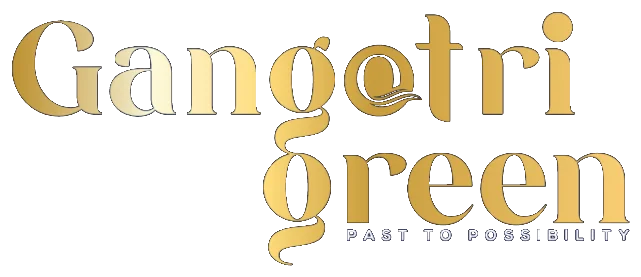

<div align="center">

<br />



<br /><br />

# 🌿 Gangotri Green Properties

### *Premium Real Estate · Pune*

> **"Settle For Life"** — Where your dream of owning land becomes a legacy for generations.

<br />


<br />

---

</div>

## 📋 Table of Contents

- [✨ Overview](#-overview)
- [🚀 Features](#-features)
- [🏗️ Project Structure](#-project-structure)
- [📦 Tech Stack](#-tech-stack)
- [🧩 Components](#-components)
- [⚙️ Getting Started](#-getting-started)
- [📜 Scripts](#-scripts)
- [🎨 Design System](#-design-system)
- [📱 Pages & Routing](#-pages--routing)
- [🏢 About the Business](#-about-the-business)
- [🤝 Credits](#-credits)

---

## ✨ Overview

**Gangotri Green Properties** is a fully animated, professional real estate landing website built for a premium property developer based in Pune, India. The site showcases NA plots, 4BHK bungalows, and gated community projects with a cinematic, luxury brand experience.

The website is designed to convert visitors into leads through stunning visual storytelling, smooth scroll-triggered animations, interactive 3D cards, and an immersive welcome splash screen.

---

## 🚀 Features

### 🎬 Cinematic Animations
- **Welcome Splash Screen** — Full-screen cinematic intro with logo, stats, countdown timer, and split-panel exit transition on every page load
- **Scroll-triggered animations** — Every section animates in on scroll and resets when scrolled away (IntersectionObserver with replay)
- **Fly-in & Fly-out** — Elements enter and exit the viewport with directional animations
- **Parallax effects** — Mouse-tracking parallax on hero section background and woman image

### 🃏 Interactive 3D Cards
- **Projects Section** — True CSS perspective tilt (±7° on both axes) tracking mouse cursor in real-time
- **Why Section** — Feature cards with icon ping rings, color-tinted hover states, and bounce animations
- **Luxury Section** — 3D tilt cards with gold glow, shimmer, and gloss reflections

### 🎨 Visual Design
- Gold (`#c9a030` / `#F5C518`) accent color throughout — matching the brand
- Ken Burns image effects on hero and about section
- SVG checkmark draw animations in Legacy section
- Gold shimmer sweep text effects
- Animated diamond dividers and gold accent bars

### 🔧 Technical
- React Router v7 with 404 Not Found page
- Auto-scrolling project carousel with pause-on-hover
- Fully accessible form with animated focus states
- WhatsApp floating button
- Responsive-ready component structure

---

## 🏗️ Project Structure

```
Green/
├── frontend/
│   ├── public/
│   │   ├── favicon.svg
│   │   └── icons.svg
│   ├── src/
│   │   ├── assets/
│   │   │   ├── gangotri-logo.webp      ← Brand logo
│   │   │   ├── hero.png
│   │   │   └── home5-img2.png          ← Luxury section image
│   │   ├── components/
│   │   │   ├── WelcomeScreen.jsx       ← Cinematic splash screen
│   │   │   ├── Navbar.jsx              ← Sticky nav with slide drawer
│   │   │   ├── HeroSection.jsx         ← Full-screen animated hero
│   │   │   ├── AboutSection.jsx        ← Founder story + stats
│   │   │   ├── LegacySection.jsx       ← "Not Just Land. A Legacy."
│   │   │   ├── WhySection.jsx          ← 4 feature cards with 3D hover
│   │   │   ├── ProjectVideoSection.jsx ← Featured project video panel
│   │   │   ├── ProjectsSection.jsx     ← 20-card auto-scroll carousel
│   │   │   ├── TestimonialsSection.jsx ← Video testimonial grid
│   │   │   ├── LuxurySection.jsx       ← Dark luxury section + features
│   │   │   ├── ContactSection.jsx      ← Centered contact form
│   │   │   ├── FooterSection.jsx       ← Full footer with links
│   │   │   ├── WhatsAppButton.jsx      ← Floating WhatsApp CTA
│   │   │   └── NotFoundPage.jsx        ← 404 error page
│   │   ├── App.jsx                     ← Routes + welcome screen logic
│   │   ├── App.css                     ← Global styles + keyframes
│   │   ├── index.css
│   │   └── main.jsx                    ← React root + BrowserRouter
│   ├── index.html
│   ├── package.json
│   ├── vite.config.js
│   └── eslint.config.js
└── README.md
```

---

## 📦 Tech Stack

| Technology | Version | Purpose |
|---|---|---|
| **React** | 19.3 | UI Framework |
| **Vite** | 8.3 | Build Tool & Dev Server |
| **React Router DOM** | 7.x | Client-side Routing |
| **React Icons** | 5.7 | Icon Library |
| **Tailwind CSS** | 4.x | Utility CSS (available) |
| **CSS Animations** | Native | All section animations |
| **IntersectionObserver** | Browser API | Scroll-triggered effects |

---

## 🧩 Components

| Component | Description |
|---|---|
| `WelcomeScreen` | Cinematic full-screen splash with logo, stats, countdown, split-exit |
| `Navbar` | Fixed nav with hamburger → slide drawer, staggered link animations |
| `HeroSection` | Full-screen hero with parallax BG, woman image, animated text |
| `AboutSection` | Founder image with Ken Burns, stats row, gold underline heading |
| `LegacySection` | Full-bleed with animated SVG checkmarks, bungalow + woman images |
| `WhySection` | 4 feature cards — icon bounce, ping ring, color tint on hover |
| `ProjectVideoSection` | Featured project with play button + dark text card |
| `ProjectsSection` | 20 auto-scrolling 3D tilt project cards with gold shimmer |
| `TestimonialsSection` | Video grid (1 large + 2 stacked) with floating CTA button |
| `LuxurySection` | Dark section with fly-in/fly-out, 3D cards, gold glow effects |
| `ContactSection` | Centered form with animated contact chips and hover effects |
| `FooterSection` | Full footer — links, social, address, 130 background icons |
| `NotFoundPage` | 404 page matching site design with countdown redirect |
| `WhatsAppButton` | Floating green WhatsApp CTA button |

---

## ⚙️ Getting Started

### Prerequisites
- **Node.js** v18 or higher
- **npm** v9 or higher

### Installation

```bash
# 1. Clone the repository
git clone https://github.com/your-username/gangotri-green.git

# 2. Navigate to the frontend directory
cd gangotri-green/frontend

# 3. Install dependencies
npm install

# 4. Start the development server
npm run dev
```

The site will be available at **http://localhost:5173**

---

## 📜 Scripts

```bash
# Start development server with hot reload
npm run dev

# Build for production
npm run build

# Preview production build locally
npm run preview

# Run ESLint
npm run lint
```

---

## 🎨 Design System

### Color Palette

| Name | Hex | Usage |
|---|---|---|
| **Gold Primary** | `#c9a030` | Borders, accents, icons |
| **Gold Bright** | `#F5C518` | Highlights, shimmer |
| **Dark Base** | `#1a1a1a` | Dark sections, text |
| **Deep Dark** | `#141414` | Luxury section BG |
| **Off White** | `#f5f5f0` | Footer background |
| **Body Text** | `#555555` | Paragraph text |

### Typography
- **Font:** Inter (Google Fonts) — weights 400, 500, 600, 700, 800
- **Headings:** 800–900 weight, tight letter-spacing (-0.5px to -1.5px)
- **Labels:** 700 weight, 2–4px letter-spacing, uppercase

### Animation Philosophy
- **Ease in:** `cubic-bezier(0.22, 1, 0.36, 1)` — fast start, gentle settle
- **Ease out:** `cubic-bezier(0.4, 0, 1, 1)` — fast exit
- **Spring:** `cubic-bezier(0.34, 1.56, 0.64, 1)` — overshoot for icons
- **Duration:** Entrances 0.7–1.3s · Exits 0.5–0.9s

---

## 📱 Pages & Routing

| Route | Component | Description |
|---|---|---|
| `/` | `HomePage` | Full landing page with welcome screen |
| `/*` | `NotFoundPage` | 404 page with auto-redirect to home |

---

## 🏢 About the Business

**Gangotri Green Properties India Private Limited**
📍 65-A, Oxford Village, Clover Village, Wanowrie, Pune, Maharashtra 411040

- 📧 support@gangotrigreen.com
- 📞 +91 93090 02202
- 🏆 Pioneers in Collector N.A. Plots across Pune
- 🌿 20+ Years · 50+ Projects · 5,000+ Happy Families

**Featured Projects:** Nivaan Grandeur, Nivaan Meadows, Nivaan Skylark, Pristine City, Nivaan Water Edge, Nivaan Sparsh, Nivaan Legacy, and many more.

---

## 🤝 Credits

<div align="center">

Built with ❤️ in India by

**[WisdomQuantums Solution](https://wisdomquantums.com)**

<br />

*© 2026 Gangotri Green Properties India Private Limited. All rights reserved.*

</div>
